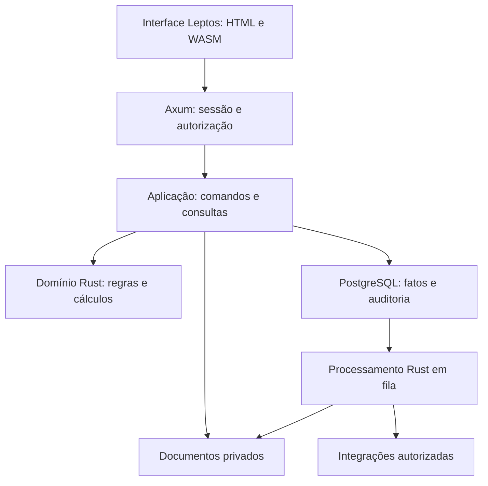

# Arquitetura em Rust

## 1. Decisão

Adotar um monólito modular em Rust, com interface Leptos, renderização no servidor, hidratação em WebAssembly e servidor Axum/Tokio. PostgreSQL é a fonte transacional; SQLx faz o acesso tipado. Documentos ficam em armazenamento privado de objetos. Um processo Rust separado executa os trabalhos demorados, usando a mesma base de domínio e uma fila persistente.

A documentação do Leptos descreve [SSR e integração oficial com Axum](https://book.leptos.dev/ssr/index.html), [hidratação](https://book.leptos.dev/getting_started/index.html) e [redução do tamanho do WASM](https://book.leptos.dev/deployment/binary_size.html). As APIs de [Axum](https://docs.rs/axum/latest/axum/), [SQLx](https://docs.rs/sqlx/latest/sqlx/) e [rust_decimal](https://docs.rs/rust_decimal/latest/rust_decimal/) fundamentam a escolha técnica. O desempenho exigido é uma decisão do produto e precisa ser medido.

**Alternativas consideradas:** Dioxus também permite interface em Rust, mas a integração SSR/Axum documentada do Leptos atende diretamente formulários, navegação e aplicação administrativa deste produto. Um cliente exclusivamente WASM atrasaria o conteúdo inicial e aumentaria a dependência do carregamento completo. Não há motivo demonstrado para dividir a primeira versão em microsserviços.

Na issue 01, fixar versões estáveis compatíveis em `rust-toolchain.toml`, `Cargo.toml` e `Cargo.lock`, compilar os alvos servidor e navegador e registrar as versões testadas. A consulta à versão mais recente de uma biblioteca não substitui essa prova. Atualizações posteriores exigem compilação, testes e análise das dependências.

## 2. Fronteiras

| Unidade planejada | Responsabilidade | Restrições |
|---|---|---|
| `crates/domain` | Valores decimais, estados, fórmulas e invariantes puras | Sem HTTP, SQL ou dependência de interface |
| `crates/application` | Casos de uso, autorização contextual e transações | Nenhuma chamada que ignore a empresa selecionada |
| `crates/persistence` | Consultas SQLx, migrações e mapeamentos | Sem regra de negócio exclusiva em gatilho oculto |
| `crates/web` | Componentes Leptos, rotas, formulários e SSR | Cliente produz prévias, nunca autoriza ou consolida fatos |
| `crates/api` | Endpoints Axum e funções de servidor | Autenticar e autorizar cada chamada, inclusive server functions |
| `crates/jobs` | Exportações, notificações, verificações e integrações | Contexto de empresa obrigatório e tentativas idempotentes |
| `crates/contracts` | Estruturas de entrada/saída e erros públicos | Separar dados serializáveis de segredos e entidades internas |
| `tools/xtask` | Comandos Rust para validação e operação | Sem scripts de negócio em outra linguagem |

Essa é a estrutura a implementar; a presente especificação não afirma que esses crates já existam.

## 3. Linguagens e interoperabilidade

Rust contém lógica de produto, cálculo, autorização, componentes, processamentos e ferramentas próprias. CSS define o visual; SQL define esquema e consultas; TOML/YAML/JSON configuram compilação e ambientes. HTML é saída renderizada. O JavaScript mínimo gerado por `wasm-bindgen` para carregar e integrar WASM é parte da cadeia de compilação, não uma aplicação paralela.

Não adotar React, Vue, um servidor Node ou uma planilha JavaScript como dependência da interface principal. Se uma integração externa exigir seu próprio código no navegador, registrar o requisito e a decisão antes de introduzi-la. Preferir redirecionamento para pagamento e assinatura hospedados pelo provedor. Conteúdo de terceiros não recebe acesso aos dados completos da obra.

## 4. Banco e isolamento

Toda entidade de cliente possui `tenant_id`. Chaves estrangeiras usam a empresa como parte da integridade referencial. PostgreSQL Row Level Security complementa a autorização da aplicação; o usuário de execução não possui `BYPASSRLS` nem é dono das tabelas. O contexto deve ser definido por transação e limpo pelo ciclo da conexão, evitando vazamento em pool. [Referência oficial de RLS](https://www.postgresql.org/docs/current/ddl-rowsecurity.html).

O usuário pode integrar mais de uma organização. Sessão identifica o usuário; cada comando identifica a organização autorizada e a obra/contrato permitido. Nunca aceitar apenas o `tenant_id` enviado no formulário. O identificador opaco de um documento não é uma autorização.

Arquivos, URLs temporárias, cache, índices de busca, relatórios, métricas, filas e restaurações obedecem ao mesmo isolamento. O suporte acessa dados apenas por concessão específica, temporária, registrada e visível à organização. O papel de suporte não pode aprovar medições ou baixar pagamentos em nome do cliente.

## 5. Transações e concorrência

Comandos recebem identificador de operação, versão esperada da entidade e contexto autenticado. Operações financeiras e de saldo usam transação, bloqueio consistente dos agregados envolvidos e restrições únicas. A chave é escopada por organização e tipo de ato, vinculada ao hash canônico da entrada. Mesma chave e mesmo conteúdo devolvem o resultado anterior após revalidar o acesso; mesma chave com conteúdo diferente gera conflito, sem sucesso silencioso. Uma organização não consulta o resultado de outra pela chave. Manter a identidade do efeito financeiro durante seu ciclo de retenção; expirar cache não apaga a prevenção de duplicidade do fato. Repetir a operação não repete seus efeitos.

Salvar uma medição definitiva exige conferir novamente versão do contrato, saldo, comissão, evidências e demais estados dentro da transação. Um orçamento alocado para edição usa concessão temporal renovável e controle de versão. A alocação melhora a experiência; a proteção contra corrida permanece no banco.

Eventos para e-mail, relatórios e integrações são registrados na mesma transação dos fatos e consumidos depois. A fila pode entregar mais de uma vez; consumidores usam chave de deduplicação. Falha de um e-mail não reverte uma medição já gravada e aparece como falha de comunicação separada.

## 6. Precisão e versionamento econômico

Seguir [cálculos](regras/calculos.md). Representação em Rust com `rust_decimal::Decimal`, serialização textual e colunas `NUMERIC` limitadas a escalas e faixas compatíveis. Não usar `serde` configurado para converter moeda em ponto flutuante. Operações intermediárias usam variantes verificadas e falham explicitamente em estouro ou perda de escala não prevista.

Cada resultado guarda versão da política de cálculo, entradas, origem dos preços, competência dos índices e decomposição. Servidor e navegador compartilham o mesmo crate para a prévia. O servidor recalcula no momento de concluir. Uma atualização do binário não reescreve medições, orçamentos ou faturas históricos.

## 7. Documentos e assinaturas

Upload passa por limite de tamanho, identificação de conteúdo, quarentena, verificação de segurança e hash. Nome original é metadado, nunca caminho de execução. Arquivos têm armazenamento privado, versão, vínculo e autorização de download. Documentos rejeitados não ficam disponíveis por URL alternativa.

Uma assinatura referencia versão e hash exatos. Aprovação interna, assinatura eletrônica, registro profissional e emissão fiscal têm significados diferentes. Atualizar um documento invalida o uso de uma assinatura da revisão anterior para a nova revisão, preservando ambas. O sistema não apresenta o upload de uma ART como validação pelo conselho.

## 8. Interface e desempenho

Leptos renderiza a navegação e o conteúdo essencial no servidor. Carregar funcionalidades mais pesadas apenas quando usadas. Não enviar lista completa de contratos ou dez mil serviços na página inicial. Busca, filtro, ordenação e paginação são do servidor; a tabela preserva foco, seleção explícita e contexto acessível. Virtualização é melhoria opcional e precisa de alternativa paginada acessível.

Operações longas geram trabalho persistente, progresso, cancelamento antes do efeito irreversível e acesso ao resultado. O navegador não confirma sucesso financeiro antes do retorno da transação. Tempo-limite de rede deve permitir consultar o estado da operação pelo identificador antes de reenviar.

Metas completas e ambiente de medição constam de [experiência](experiencia.md) e [prontidão](prontidao-comercial.md). Base: LCP p75 até 2,5 s, INP até 200 ms e CLS até 0,1; WASM inicial Brotli até 1 MiB, interoperabilidade JS até 80 KiB e CSS até 60 KiB. Fontes próprias e imagens da interface são orçadas separadamente. Conexão lenta e máquina intermediária fazem parte da verificação.

## 9. Uso em campo

A versão 1.0 permite consulta de escopo autorizado e preparação de diário, fotos e avaliações em rascunho com conexão intermitente em aba previamente carregada. Abrir ou reabrir a aplicação exige rede; após reconectar e autenticar, recuperar rascunhos persistidos. Não há promessa de inicialização sem conexão nesta versão. A interface orienta preparar a sessão antes de ir ao campo. IndexedDB e APIs do navegador são acessadas a partir de Rust. O dispositivo guarda apenas o conjunto autorizado. Autorização local tem validade máxima de 8 horas desde a última verificação do servidor, reduzível pela organização; expirou, exigir rede antes de nova consulta/sincronização. Rascunhos não enviados têm retenção máxima de 7 dias, com aviso e recuperação controlada. Sair ou trocar organização limpa o conjunto consultável e protege rascunhos pendentes conforme a política. Revogação remota só chega ao dispositivo na reconexão; não prometer remoção instantânea em navegador desconectado. Não prometer sigilo absoluto do armazenamento de um navegador comprometido.

Aprovação, medição definitiva, alteração contratual e baixa financeira exigem conexão e revalidação no servidor. A sincronização usa identificadores únicos, base de versão e resolução explícita de conflito. Revogação ocorrida durante a ausência de rede impede a gravação ao reconectar; o conteúdo pendente permanece recuperável de forma autorizada, sem ser aprovado automaticamente.

## 10. Segurança e operação

Sessões em cookies seguros, `HttpOnly`, proteção CSRF, política de origem e controle de tentativas. Não colocar segredos em WASM, HTML SSR, URL ou armazenamento do navegador. Senhas locais usam Argon 2 id por biblioteca Rust mantida, salt aleatório único e parâmetros versionados. Baseline inicial: memória 64 MiB, três iterações e paralelismo 1, verificada sob carga; ajustes precisam justificar custo e não ficar abaixo da referência OWASP vigente. Rehash progressivo ao autenticar quando a política evoluir. Alternativa de provedor de identidade exige decisão e fronteira documentadas, sem armazenar senha local. Recuperação usa token aleatório criptográfico de pelo menos 256 bits, expiração de até 15 minutos, hash persistido e uso único. Senhas e tokens em claro não entram no banco nem em logs. Reset não desativa MFA nem concede sessão privilegiada. Seguir as referências de [armazenamento de senhas](https://cheatsheetseries.owasp.org/cheatsheets/Password_Storage_Cheat_Sheet.html) e [recuperação](https://cheatsheetseries.owasp.org/cheatsheets/Forgot_Password_Cheat_Sheet.html). MFA obrigatório para administração, aprovação financeira e suporte privilegiado; meios acessíveis de recuperação e revogação.

Os ambientes de desenvolvimento, homologação e produção possuem bancos, objetos, chaves e contas de provedores separados. A publicação é reproduzível, com versão e migrações identificadas. Migração que destrói dados exige backup validado e plano de conversão; voltar o binário não é, por si, desfazer uma migração.

Métricas, logs e rastreamentos não incluem documentos, senhas ou corpos completos com dados pessoais. Registrar identificadores e eventos necessários ao diagnóstico. A operação mantém alertas, fila de falhas, status, procedimento de incidente, recuperação e exportação de saída.

## 11. Verificação

Testes de domínio em Rust, casos de referência decimais, propriedades de saldo, integração com PostgreSQL real, teste de isolamento e concorrência. E2E pode usar cliente WebDriver em Rust, com navegador e driver fixados. Ferramentas de auditoria externas podem ser executadas, mas não se tornam lógica de aplicação.

Antes de aceitar uma issue de negócio, conferir caminhos de sucesso, erro, falta de permissão, empresa incorreta, duplicidade, versão antiga e operação interrompida. Acessibilidade exige teclado e leitor de tela, além de verificações automáticas. A última issue exige evidência da versão publicada; resultados de uma versão anterior não substituem essa prova.
